<div align="center">


# 工业时序智能体

**Industrial Time Series Agent**

让工业数据从自然语言问题，走向可执行的分析、预测与业务洞察。


[产品界面](#产品界面) · [核心能力](#核心能力) · [业务智能体](#业务智能体) · [系统架构](#系统架构) · [快速开始](#快速开始) · [开发与验证](#开发与验证)

</div>

## 项目简介

工业时序智能体是面向设备、工艺、生产与市场数据的多智能体分析平台。用户可以上传数据、复用已有资产，或进入业务智能体，用自然语言和结构化配置完成数据分析、异常检测、时序预测、根因分析与生产业务查询。

平台提供两类工作方式：**通用对话工作台**负责画像、字段映射、方案选择和专业工具执行；**业务智能体工作区**按设备域、生产域、市场域组织应用，让任务配置与工厂场景直接对应。制造、品质、成本、设备 BI，以及 NG 问数和 Control Plan 查询通过独立服务接入各自的数据与确认流程。

- **从提问到执行**：识别意图、生成方案、解析参数，在需要时请求人工确认，再调用分析工具。
- **让结果可检查**：展示结构化指标、交互图表、训练进度、字段映射与查询筛选条件。
- **让资产可复用**：统一管理私有数据、公共数据和三类模型，业务入口共用数据选择器。
- **连接业务现场**：工厂目录承载专属 BI 与 NG 应用，通用目录承载配置型分析和预测任务。

## 产品界面

### 登录与通用对话

<details>
<summary><strong>登录与账户</strong> · 三维首页与登录表单</summary>

基于 Three.js 的时序档案室，支持切换信号通道与采样窗口。账户支持用户名或邮箱登录、邮箱验证码注册、密码找回与旧账户邮箱绑定。

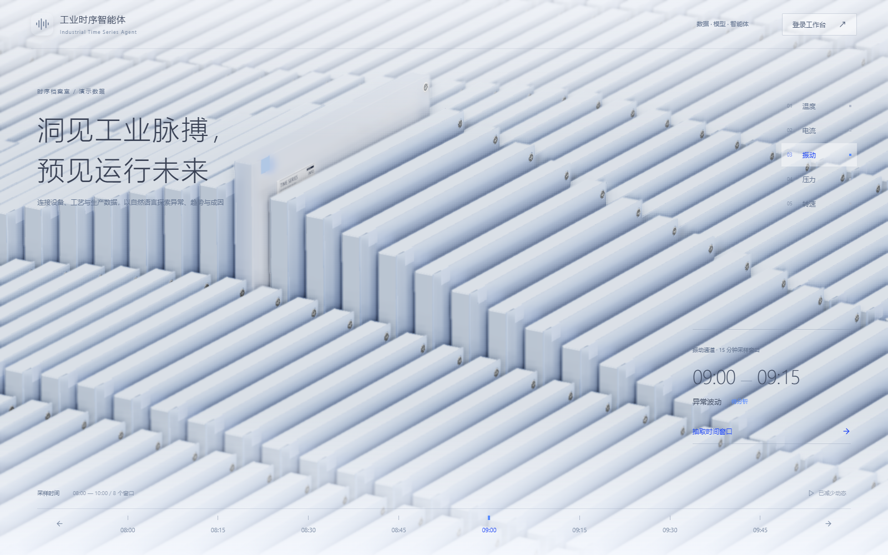

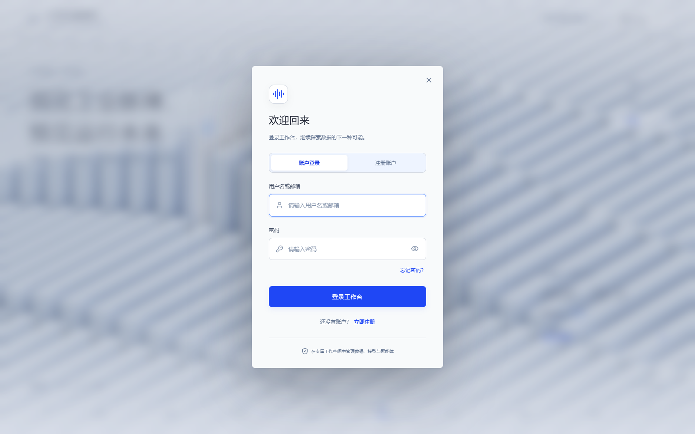

</details>

在通用对话工作台完成自然语言提问、数据上传、历史会话访问和任务状态查看。阶段与准备状态仅在通用对话页面显示，资源管理与业务应用使用自己的页面标题。

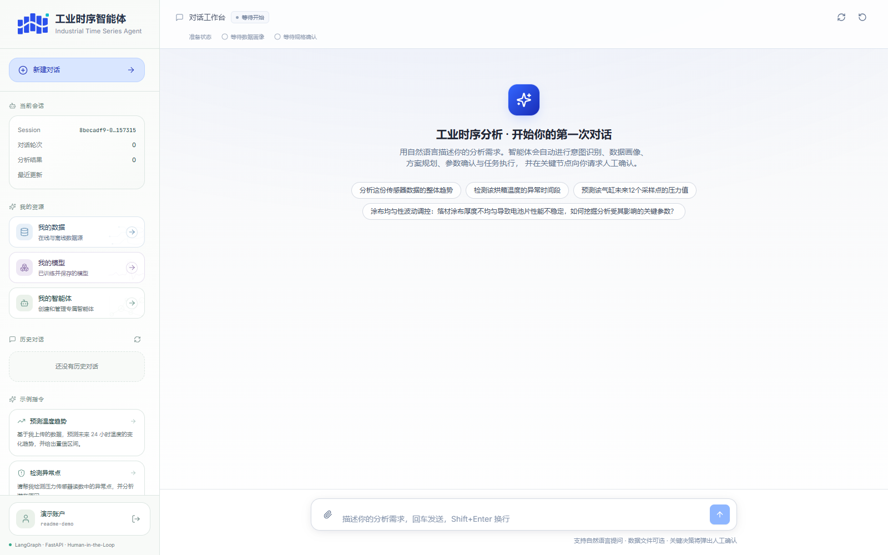

### 我的数据

<details>
<summary><strong>展开我的数据</strong> · 在线数据源 → 离线数据源 → 私有 / 公共数据</summary>

在线工厂数据与离线文件分开管理。在线来源可进入工厂和数据表，查看预览、筛选与质量概览；离线来源分为当前账户的私有数据和只读公共数据。

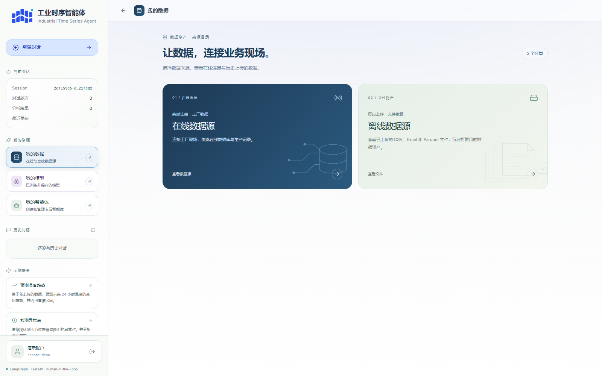

#### 离线私有数据

历史上传文件与在线预览导出文件可在这里预览，并复用于后续任务。下图文件名称与元数据均为演示内容。

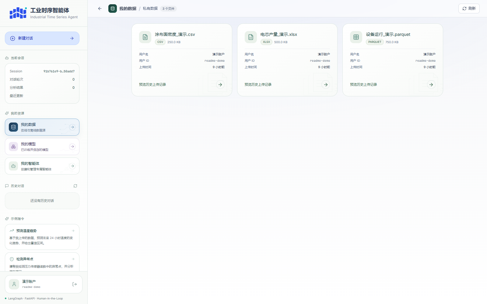

</details>

### 我的模型

<details>
<summary><strong>展开我的模型</strong> · 数据分析 → 异常检测 → 时序预测</summary>

模型按照任务能力分类，进入分类后查看已训练并保存的模型及其元数据。下图三类各一条模型记录为演示数据。

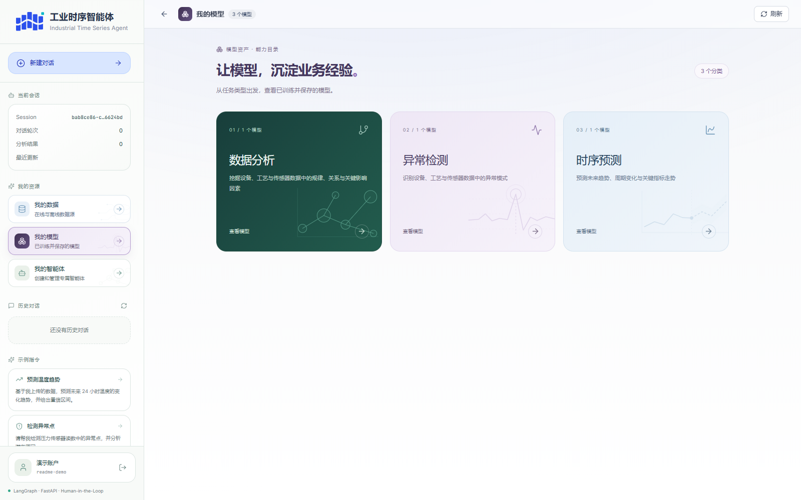

</details>

### 我的智能体

<details>
<summary><strong>展开我的智能体</strong> · 设备域 → 生产域 → 市场域</summary>

智能体按业务领域组织；每个领域再进入通用能力或工厂专属空间。以下展开顺序与平台目录一致。

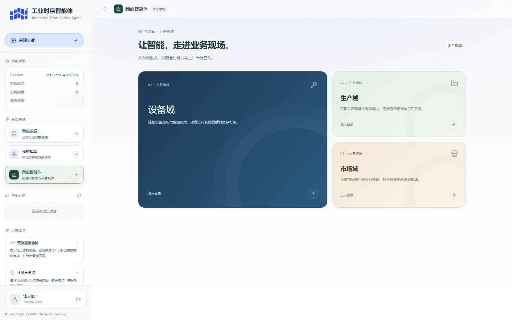

<details>
<summary><strong>设备域</strong> · 通用智能体与工厂目录</summary>

当前设备域通用能力包含涂布面密度分析、涂布异常检测、气缸 / 伺服电机 / 焊接设备异常检测，以及电芯分容容量偏低根因分析。

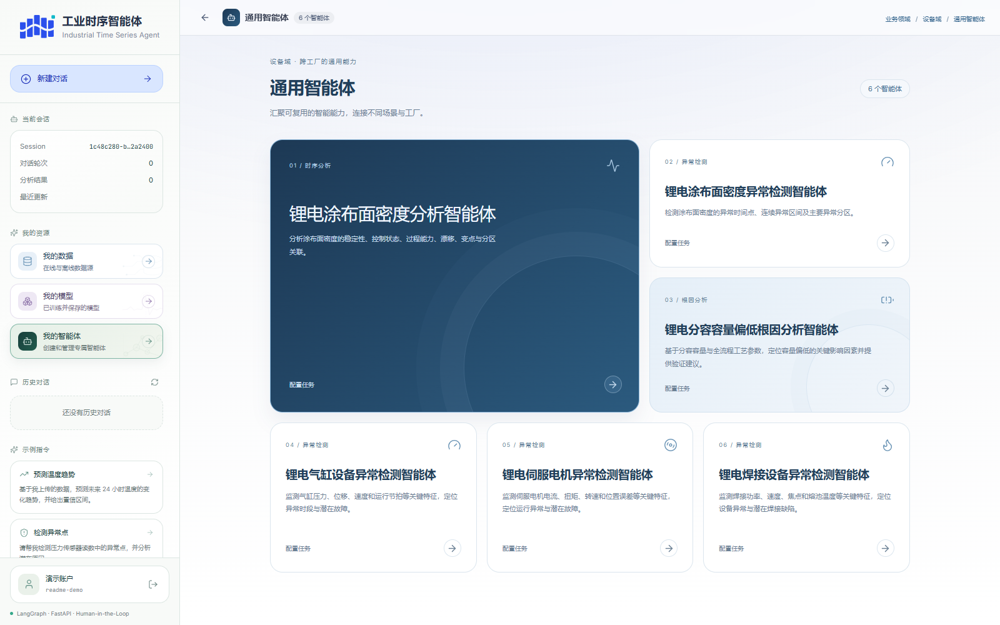

</details>

<details>
<summary><strong>生产域</strong> · 通用智能体 → 工厂智能体</summary>

生产域先选择通用能力或具体工厂，再进入对应智能体。

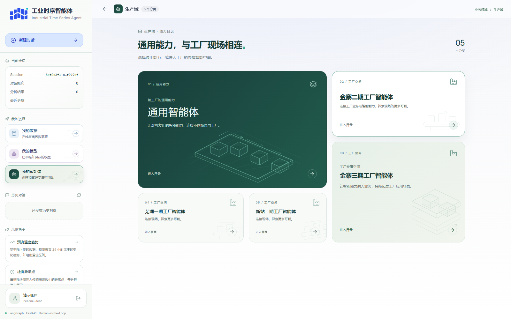

<details>
<summary><strong>通用智能体</strong> · 产量预测、能耗预测与 Control Plan</summary>

通用能力包含电芯产量预测、PACK 产量预测、工厂能耗预测，以及锂电产线 Control Plan 分析。

#### Control Plan 工艺参数查询

按基地、路线、工序逐层确认工艺参数范围，展示标准、检验要求及分析建议。

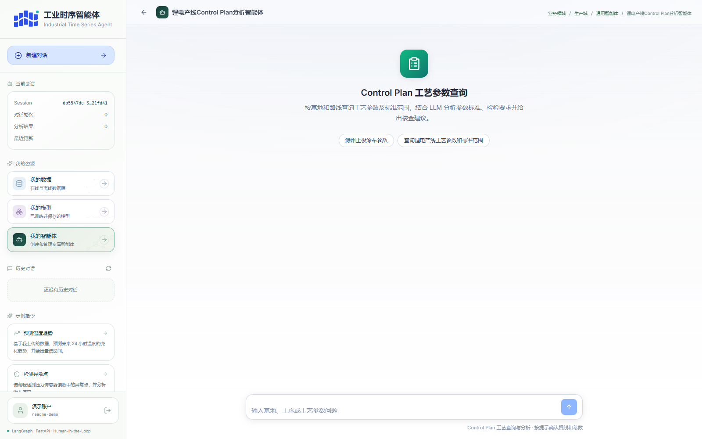

</details>

<details>
<summary><strong>工厂智能体</strong> · 制造 / 品质 / 成本 / 设备 BI 与 NG 问数</summary>

金寨二期、金寨三期和芜湖一期目录配置了四类 BI 与不良品类型分析入口；新站二期目录目前为空。

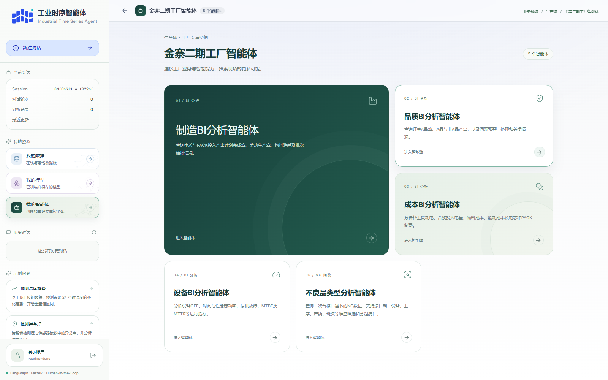

#### 制造 BI 分析

进入工厂后，用业务语言查询投入产出、工时与物料指标。其他 BI 与 NG 入口使用各自的业务查询和确认流程。

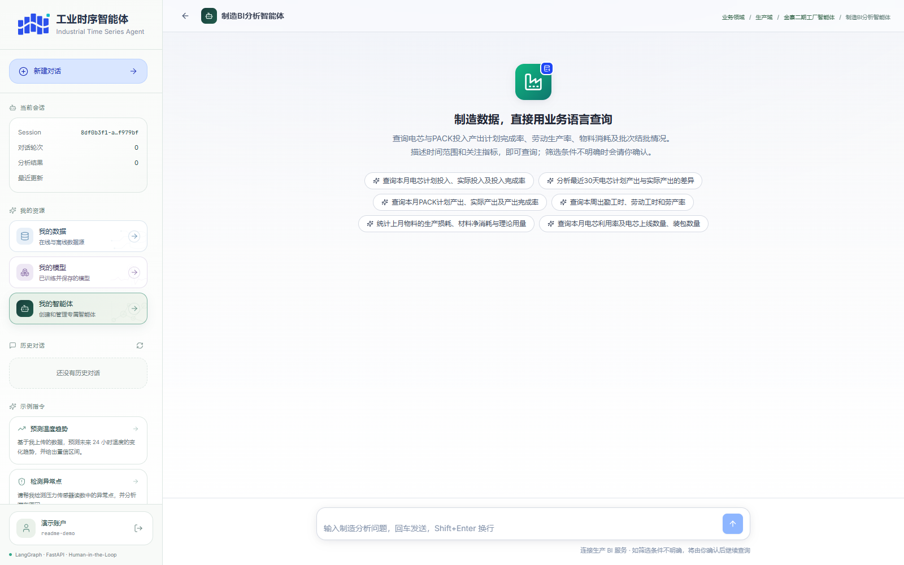

</details>

</details>

<details>
<summary><strong>市场域</strong> · 装车量、汽车销量、原材料价格与 SOH 预测</summary>

市场域通用能力包含动力电池装车量预测，新能源汽车及零跑、吉利、长城品牌销量预测，锂电原材料价格预测和电芯 SOH 预测。

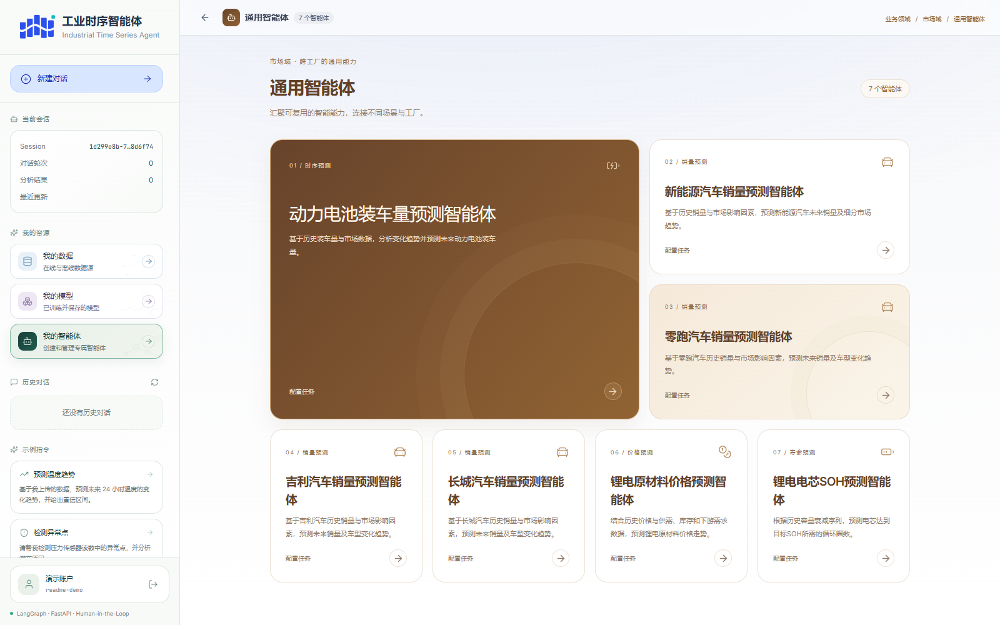

</details>

</details>

## 核心能力

| 能力 | 当前实现 |
| --- | --- |
| 多智能体编排 | LangGraph 编排意图路由、通用对话、技术方案、数据画像、参数解析和专业任务执行 |
| 人工确认 | 技术路径选择、文件补充、字段映射澄清、模型选择，以及业务查询的分步确认与恢复 |
| 数据分析 | 描述统计、质量检查、分布、趋势、相关性、互信息、时序分解、平稳性、变点、SPC、过程能力和组间比较 |
| 根因分析 | CatBoost 目标建模、FeatureImportance 与 TreeSHAP，支持保存和复用分析模型 |
| 异常检测 | PyOD 扩展、时序检测器、滑窗桥接、自动推荐、训练与加载、阈值、集成、评估及解释 |
| 时序预测 | 七个外部时序基础模型、分位数预测、多模型比较、集成、回测和指定模型的远程微调 |
| 结果展示 | 预测与回测图、异常点及区间、训练进度、直方图、相关性热力图、分解图、控制图、ACF/PACF、根因图表 |
| 数据资产 | CSV / XLSX / Parquet 文件、私有与公共离线数据、在线表预览、筛选、质量概览和展示快照导出 |
| 模型资产 | 分析与异常检测模型本地持久化；远程微调模型保存本地索引并在后续任务中复用 |
| 会话与认证 | Bearer token、历史对话重放、用户与会话归属校验、用户命名空间内的数据和模型资产 |
| 生产业务查询 | 制造 / 品质 / 成本 / 设备 BI、NG 不良品类型统计、Control Plan 查询及结果分析 |

### 分析、检测与预测

分析工具位于 [analysis_tools](agent_app/tools/analysis_tools/)，读取运行时注入的 DataFrame、目标列与特征列。工具执行结果形成统一结构，再由专业 Agent 解释。根因分析提供模型与统计层面的影响线索，不直接证明因果关系。

异常检测工具位于 [anomaly_detection_tools](agent_app/tools/anomaly_detection_tools/)。除通用检测器外，包含 SpectralResidual、MatrixProfile、SAND、TimeSeriesOD、LSTMAD、AnomalyTransformer 等时序能力；具体可选模型以对应业务表单及运行环境为准。

预测工具位于 [prediction_tools](agent_app/tools/prediction_tools/)，当前模型注册表包含：

| 模型 ID | 模型 ID | 模型 ID |
| --- | --- | --- |
| `sundial` | `toto-2` | `timer-s1` |
| `chronos-2` | `timesfm-2.5` | `moirai-2.0-R-small` |
| `tirex-1.1-gifteval` | | |

预测由外部 HTTP 服务执行，输出统一为点预测与分位数等结构。Chronos-2 支持 full / LoRA 微调，TimesFM 2.5 支持 LoRA 微调；微调权重保留在远程服务，本地记录模型索引。需要自行接入可访问的推理与微调服务，仓库不附带这些模型权重或服务。

### 数据接入与复用

- **私有数据**：按当前账户隔离的历史上传文件，可预览并用于后续任务。
- **公共数据**：来自 `agent_app/public_datasets/` 的只读共享文件。
- **在线数据**：读取配置中的工厂数据源，提供数据表目录、字段信息、字符列筛选、预览图表及质量概览。当前在线表要求存在 `insert_time` 字段。
- **配置型任务选数**：在线表先限定最近 5,000 条记录，再按时间升序准备为任务文件；公共文件或在线数据副本进入原有上传及分析链路。
- **预览快照导出**：将界面当前已展示的记录及所选字段导出为私有 CSV，不重新查询整表；与上面的 5,000 条任务选数范围不同。导出接口最多接收 500 行。

文件接入支持 CSV、XLSX、Parquet，默认上限为 100 MB；部分业务表单仍限定 CSV，以表单提示为准。在线预览、质量概览和任务选数都有取样范围，不能将样本指标视作整表统计。

## 业务智能体

业务入口按照 **领域 → 通用能力 / 工厂空间 → 智能体** 组织。入口数量会因工厂复用而增加，不等同于独立算法数量。

### 设备域

| 当前业务入口 | 任务方向 |
| --- | --- |
| 涂布面密度分析、涂布面密度异常检测 | 稳定性、SPC、过程能力、时序波动和异常区间 |
| 气缸、伺服电机、焊接设备异常检测 | 压力、位移、电流、扭矩、振动及焊接工艺参数等 |
| 电芯分容容量偏低根因分析 | 关键影响因素建模与解释 |

### 生产域

| 目录 | 当前业务入口 | 任务方向 |
| --- | --- | --- |
| 通用智能体 | 电芯产量、PACK 产量、工厂能耗预测 | 产出、产能缺口及能耗走势 |
| 通用智能体 | 锂电产线 Control Plan 分析 | 工艺参数、标准范围和检验要求查询 |
| 工厂智能体 | 制造、品质、成本、设备 BI 分析 | 投入产出、A 品率、成本、能耗、OEE、MTBF / MTTR 等 |
| 工厂智能体 | 不良品类型分析 | 按 NG 类型及日期、设备、工序等白名单维度统计 |

### 市场域

| 当前业务入口 | 任务方向 |
| --- | --- |
| 动力电池装车量预测 | 电池类型、历史装车量及外生变量 |
| 新能源汽车、零跑、吉利、长城汽车销量预测 | 品牌 / 车型选择与月度、季度预测 |
| 锂电原材料价格预测、电芯 SOH 预测 | 原材料价格走势与容量衰减 |

当前生产域包含通用智能体、金寨二期、金寨三期、芜湖一期和新站二期目录。前三个工厂目录已配置四类 BI 与 NG 入口；新站二期目录目前为空。前端配置分别传递 BI 的工厂租户和 NG 的工厂标识，二者不应混用。

配置型分析 / 预测任务由 [applications/registry.py](agent_app/applications/registry.py) 校验并编译为通用任务；BI、NG、Control Plan 走独立的 `bi_app` 接口，不要求经过通用对话的数据画像和规格确认流程。

### 生产查询的三条链路

| 链路 | 数据来源与执行方式 | 交互与结果 |
| --- | --- | --- |
| 四类 BI | 独立适配层转发远程 BI 服务，携带工厂租户参数 | 字段筛选确认、结果表格及对应领域的 LLM 分析 |
| NG 问数 | LangGraph 工作流解析问题、匹配数据库真实候选，执行固定的只读 SQL 模板 | 可搜索和分页的筛选、多维统计、图表、断点恢复 |
| Control Plan | 独立适配层调用远程工艺参数服务 | 基地 → 路线 → 工序 → 参数的多选确认，动态表格及专用分析 |

BI 和 Control Plan 的结果分析失败时保留原始查询表格；分析基于本次返回数据，不推断未提供的预算、阈值、实测超标或严格因果。NG 会话按账户、工厂和线程隔离；当前工厂租户选择不等同于完整的企业数据权限系统。

## 系统架构

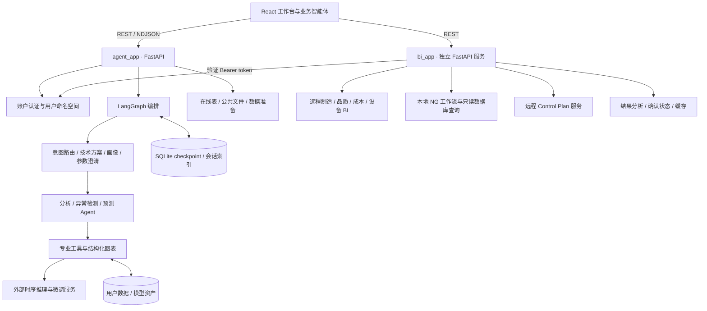

通用对话的典型过程是：**提出任务 → 方案选择 → 上传或复用数据 → 数据画像与参数映射 → 必要时澄清 → 专业 Agent 执行 → 图表与解释**。具体节点由任务状态决定，并非每轮都重复执行全部流程。

主接口使用 **multipart/form-data 请求 + NDJSON 流式响应**，不是 WebSocket。业务 BI 接口返回 JSON，并通过线程及确认字段续接查询。

### 技术栈

| 层次 | 技术 |
| --- | --- |
| 前端 | React 18、TypeScript、Vite 5、Tailwind CSS、React Router、Recharts、Lucide、Three.js |
| Agent 编排 | LangChain、LangGraph、OpenAI 兼容 Chat Completions 接口 |
| 主服务与业务服务 | FastAPI、Uvicorn、Pydantic v2、HTTPX、PyMySQL |
| 分析与模型 | pandas、NumPy、SciPy、scikit-learn、statsmodels、CatBoost、PyOD 扩展、PyTorch |
| 持久化 | SQLite 账户库、会话索引、LangGraph checkpoint、本地模型资产与远程模型索引 |
| 部署 | Python 3.12 / Node 20 镜像、Docker Compose、可选 Nginx 静态前端与反向代理 |

## 快速开始

### 1. 配置服务

主服务需要可用的 OpenAI 兼容模型接口。在 `agent_app/.env` 中配置，已有配置请保留并按需修改：

```dotenv
MODEL_NAME=your-chat-model
BASE_URL=https://your-model-service.example/v1
API_KEY=your-api-key
TEMPERATURE=0.7
TIMEOUT=600
MAX_FILE_SIZE_MB=100
```

邮箱注册、找回密码和绑定邮箱需要 SMTP，按 [账户与邮件配置说明](agent_app/auth/README.md) 将 [auth.env.example](agent_app/auth.env.example) 中的设置补入该文件。未配置 SMTP 时不能正常申请验证码，已有账户仍可登录。

业务服务配置放在 `bi_app/.env`，按所需能力填写：

```dotenv
AUTH_SERVICE_URL=http://127.0.0.1:8000
BI_REMOTE_QUERY_URL=http://your-bi-service.example/api/query
CONTROL_PLAN_QUERY_URL=http://your-control-plan-service.example/api/query
```

NG 数据库及结果分析模型设置见 [ng.env.example](bi_app/ng.env.example)；更多配置见 [BI 服务说明](bi_app/README.md)。在线数据库连接维护在 [online_sources.py](agent_app/config/online_sources.py)，预测服务路由维护在 [prediction_tools/_common.py](agent_app/tools/prediction_tools/_common.py)，微调配置见 [finetuning_tools.py](agent_app/tools/prediction_tools/finetuning_tools.py)。这些集成需要对应服务和网络访问，不能仅安装 Python 依赖后直接获得全部能力。

### 2. 本地开发

从仓库根目录创建虚拟环境。后端依赖以 [requirements.txt](requirements.txt) 为准，Python 版本可与 Docker 保持为 3.12；前端可使用 Node 20。

```bash
python -m venv .venv
```

激活环境：

```powershell
# Windows PowerShell
.\.venv\Scripts\Activate.ps1
```

```bash
# Linux / macOS
source .venv/bin/activate
```

安装依赖并在两个终端分别启动主服务、业务服务：

```bash
python -m pip install -r requirements.txt

# 终端一：主后端
python -m uvicorn agent_app.api:app --env-file agent_app/.env --host 0.0.0.0 --port 8000 --reload

# 终端二：BI / NG / Control Plan
python -m uvicorn bi_app.api:app --env-file bi_app/.env --host 0.0.0.0 --port 8010 --reload
```

第三个终端启动前端，Vite 的两个代理均需指向本机服务：

```powershell
# Windows PowerShell
cd frontend
npm ci
$env:VITE_PROXY_TARGET="http://127.0.0.1:8000"
$env:VITE_BI_PROXY_TARGET="http://127.0.0.1:8010"
npm run dev
```

```bash
# Linux / macOS
cd frontend
npm ci
VITE_PROXY_TARGET=http://127.0.0.1:8000 VITE_BI_PROXY_TARGET=http://127.0.0.1:8010 npm run dev
```

前端访问 [localhost:5173](http://localhost:5173)，主后端文档访问 [localhost:8000/docs](http://localhost:8000/docs)，业务服务文档访问 [localhost:8010/docs](http://localhost:8010/docs)。两个后端均提供 `/health`。

### 3. Docker Compose

使用支持当前 Compose 文件语法的 Docker Compose v2。当前配置偏向开发：源码挂载、Uvicorn reload、Vite 开发服务器；不应将其描述为已加固的生产部署。

主后端的 `build` 配置目前被注释，使用本地镜像 `ts_agent-backend:custom-20261029`。首次部署先构建该镜像：

```bash
docker build --target backend -t ts_agent-backend:custom-20261029 .
docker compose up -d --build
docker compose ps
```

Compose 从 `agent_app/.env` 和 `bi_app/.env` 注入环境。`AUTH_SERVICE_URL` 已在 Compose 中指定为 `http://backend:8000`。`BI_REMOTE_QUERY_URL` 则由 Compose 的 `environment` 显式赋值，优先于业务服务的 `env_file`：使用 Compose 时，应在**仓库根目录 `.env`** 设置该变量，或通过运行 Compose 的 shell 传入自己的地址。

```dotenv
# 仓库根目录 .env 中的 Compose 覆盖项
BI_REMOTE_QUERY_URL=http://your-bi-service.example/api/query
FRONTEND_PORT=5173
BACKEND_PORT=8000
```

前端与主后端默认暴露 5173、8000 端口；`bi-backend` 的 8010 端口默认仅供容器网络内部使用。查看日志：

```bash
docker compose logs -f backend bi-backend frontend
```

Dockerfile 还提供最终 `frontend` 构建阶段，使用 Nginx 托管静态文件；当前 Compose 选择的是 `frontend-build` 阶段并运行 Vite。切换静态部署时需配合 [nginx.conf](docker/nginx.conf) 调整服务与端口，保留通用对话流式接口的禁缓冲及业务查询的超时配置。

## 配置与持久化

| 配置 | 用途与位置 |
| --- | --- |
| `MODEL_NAME` / `BASE_URL` / `API_KEY` | 主 Agent 的模型服务，显式配置自己的服务与密钥 |
| `TEMPERATURE` / `TIMEOUT` | 主模型温度与超时，默认 0.7 / 600 秒 |
| `MAX_FILE_SIZE_MB` | 文件接入默认上限 100 MB；部分专用接口另有固定上限 |
| `SMTP_*` | 邮箱验证码发送，配置在主服务环境 |
| `AUTH_DB_PATH` | 账户 SQLite 路径，默认 `agent_app/auth/auth.sqlite3` |
| `AUTH_SERVICE_URL` | BI 用于校验 token 的主服务地址 |
| `BI_REMOTE_QUERY_URL` | 四类 BI 的上游服务地址 |
| `CONTROL_PLAN_QUERY_URL` | 工艺参数上游服务地址 |
| `BI_NG_LLM_*` / 工厂数据库变量 | NG、业务结果分析和工厂连接，见业务服务配置示例 |
| `VITE_PROXY_TARGET` / `VITE_BI_PROXY_TARGET` | 开发服务器的主服务与业务服务代理目标 |
| `VITE_API_BASE_URL` | 前端 API 基址，留空时使用同源代理 |

主要持久化位置：

```text
uploads/<user_id>/                           # 私有任务数据
agent_app/public_datasets/                    # 只读公共离线文件
agent_app/auth/auth.sqlite3                   # 账户、验证码及登录会话
agent_app/sessions.db                         # 用户会话索引
agent_app/orchestrator.db                     # 主编排 checkpoint
agent_app/artifacts/analysis_models/          # 分析模型
agent_app/artifacts/anomaly_detection/        # 异常模型
agent_app/artifacts/prediction_models/        # 远程预测模型本地索引
bi_app/.state/                               # NG checkpoint 与分析缓存
```

主编排实际 checkpoint 路径在 `orchestrator_graph.py` 中定义，不应仅修改通用 `DB_*` 配置就假定完成了迁移。SQLite 初始化失败时会降级到内存，届时重启不能保留该编排状态。当前 NG 工作流使用进程内串行锁，建议按现有单 worker 方式运行；多实例需要另行设计共享锁和持久化。

## API 速览

受保护接口使用 `Authorization: Bearer <token>`。服务端从 token 推导用户身份；客户端自行提交 `X-User-Id` 不能作为认证凭证。

| 服务 | 方法与路径 | 用途 |
| --- | --- | --- |
| 主服务 | `POST /api/query` | 通用对话与配置型任务，multipart 请求 / NDJSON 响应 |
| 主服务 | `GET /api/session/{id}` / `DELETE /api/session/{id}/reset` | 查询状态 / 重置当前任务 |
| 主服务 | `GET /api/sessions` / `GET /api/sessions/{id}/messages` | 会话目录 / 历史重放 |
| 主服务 | `DELETE /api/sessions/{id}` | 删除当前用户的会话 |
| 主服务 | `GET /api/datasets` / `GET /api/public-datasets` | 私有 / 公共数据 |
| 主服务 | `GET /api/online-sources` 及其表格子接口 | 工厂、表目录、预览、筛选候选与质量指标 |
| 主服务 | `POST /api/data-selection` | 准备公共文件或在线表任务数据 |
| 主服务 | `POST /api/data-selection/export` | 当前表格快照导出到私有数据 |
| 主服务 | `GET /api/models` | 三类模型资产 |
| 主服务 | `/api/auth/*` | 验证码、注册、登录、找回、绑定、退出及会话校验 |
| 业务服务 | `POST /api/bi/query` | 制造 / 品质 / 成本 / 设备 BI |
| 业务服务 | `POST /api/bi/ng/query` / `POST /api/bi/ng/options` | NG 查询恢复 / 真实筛选候选 |
| 业务服务 | `POST /api/bi/control-plan/query` | Control Plan 查询与多选确认 |

通用任务示例，`curl.exe` 可用于 Windows，Linux / macOS 使用 `curl`：

```bash
curl -N http://localhost:8000/api/query \
  -H "Authorization: Bearer <your-token>" \
  -F "session_id=demo-analysis-001" \
  -F "query=分析这份传感器数据的整体趋势与稳定性" \
  -F "file=@./sensor.csv"
```

也可提交 `existing_file_name` 复用私有文件，通过 `application_id` 和 JSON 字符串 `application_params` 发起配置型任务，或以 `resume_value` 恢复中断。必填字段、确认协议和响应结构以当前服务的 `/docs` 为准。

## 项目结构

```text
Industrial_Time_Series_Agent/
├── agent_app/
│   ├── agents/                 # 编排、路由、画像、解析与三个专业 Agent
│   ├── applications/           # 配置型业务任务参数与 query 构建器
│   ├── auth/                   # 邮箱验证、账户与 Bearer 会话
│   ├── charts/                 # 结构化图表事件构建
│   ├── config/                 # 模型配置与在线数据源
│   ├── models/                 # 状态和接口模型
│   ├── prompts/                # Agent 提示词
│   ├── state/                  # 会话状态和记忆
│   ├── tools/                  # 分析、检测、预测、画像与内置 PyOD 扩展
│   ├── api.py                  # 主 API 和资产接口
│   ├── data_selection_api.py    # 跨来源任务选数和预览导出
│   └── public_datasets_api.py   # 公共文件接口
├── bi_app/
│   ├── api.py                  # 独立业务服务入口
│   ├── analysis.py             # BI 领域分析与缓存
│   ├── control_plan.py         # Control Plan 协议适配
│   ├── control_plan_analysis.py # 工艺标准分析
│   └── ng/                     # NG 解析、匹配、只读查询与断点工作流
├── frontend/
│   ├── public/brand/           # 新版 SVG Logo
│   ├── src/components/         # 对话、图表、资产、认证与布局
│   ├── src/context/            # 账户与通用会话状态
│   ├── src/features/agent-apps/ # 业务目录、配置表单、BI 与 Control Plan 页面
│   ├── src/services/           # API 客户端
│   └── scripts/                # 前端业务逻辑检查
├── docs/images/                # 当前 README 的 13 张界面截图
├── docker/nginx.conf           # 静态前端反向代理配置
├── docker-compose.yml
├── Dockerfile
└── requirements.txt
```

## 开发与验证

前端构建与现有业务逻辑检查：

```bash
cd frontend
npm run build
npm run test:bi-analysis
npm run test:ng-chart
npm run test:online-metrics
npm run test:vehicle-sales
```

后端按改动范围运行测试，例如在已安装项目依赖的虚拟环境中：

```bash
python -m pip install pytest
python -m pytest agent_app/auth/test_auth.py agent_app/test_session_ownership.py -q
python -m pytest agent_app/test_data_selection.py agent_app/test_online_preview_export.py -q
python -m pytest bi_app/test_api.py bi_app/test_auth.py bi_app/test_analysis.py -q
python -m pytest bi_app/test_control_plan.py bi_app/test_control_plan_analysis.py bi_app/ng/test_ng.py -q
```

这些测试大量使用临时数据库、模拟远程接口及模型响应，不能替代真实 SMTP 投递、数据库连接、模型推理和生产 BI 的端到端验收。

### 扩展入口

- 新增配置型任务：在 `agent_app/applications/` 增加参数校验与 query 构建器，注册到 `registry.py`，再添加前端表单及目录元数据。
- 新增工厂应用：更新前端 `production-catalog` 目录，分别配置 BI 租户和 NG 工厂连接；仅增加卡片不会自动建立后端数据权限或服务连接。
- 新增分析工具：遵循运行时上下文和统一返回结构，注册工具，必要时补充图表提取器及前端图表组件。

### 部署边界

当前代码面向单机及内网集成，包含开发环境的默认服务地址和数据源连接配置。部署或公开仓库前应替换其中的实际连接信息、移除明文凭据，并持久化账户、checkpoint、上传文件和模型资产；文档中的示例均使用占位地址。

模型结果依赖数据质量与上游服务。根因解释属于影响线索，预测属于模型估计；Control Plan 标准查询不等于实测质量判定。模型文件应只从可信的系统资产目录加载。

## 进一步阅读

- [账户与邮件配置](agent_app/auth/README.md)
- [BI、NG、Control Plan 服务与部署说明](bi_app/README.md)
- [工具组织说明](agent_app/tools/README.md)
- [预测微调说明](agent_app/tools/finetuning_README.md)
- [微调接口规格](agent_app/tools/prediction_tools/finetuning_SPEC.md)
- [API 补充文档](agent_app/API_USAGE.md)（与代码不一致时以当前 `/docs` 为准）
- [登录场景的 RhineLabUI 集成与第三方许可](frontend/src/components/auth/rhine/README.md)
- [截图来源与演示数据说明](docs/images/README.md)
